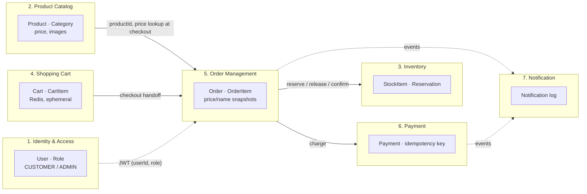

# Bounded Contexts

| Context | Service | Store | Owns | Publishes | Consumes |
|---|---|---|---|---|---|
| Identity & Access | Identity (Spring Boot) | PostgreSQL `identity_db` | users, roles, refresh tokens | — (MVP) | — |
| Product Catalog | Product (FastAPI) | PostgreSQL `product_db` | products, categories | — (MVP) | — |
| Inventory | Inventory (Go) | PostgreSQL `inventory_db` | stock, reservations | InventoryReserved / ReservationFailed (Phase 5 saga) | — |
| Shopping Cart | Cart (FastAPI) | Redis | carts (TTL 7d) | — | — |
| Order Management | Order (Go) | PostgreSQL `order_db` | orders, order items | OrderCreated, OrderConfirmed, OrderCancelled | PaymentSucceeded / PaymentFailed (Phase 5) |
| Payment | Payment (Go) | PostgreSQL `payment_db` | payments, idempotency keys | PaymentSucceeded, PaymentFailed | — |
| Notification | Notification (FastAPI) | PostgreSQL `notification_db` | notification log | — | Order*, Payment*, NotificationRequested |

Anti-corruption rules: Order stores product name + unit-price snapshots; it never re-reads Product prices for existing orders. Cart holds only `productId + qty`; prices are resolved at checkout from Product, then snapshotted into the order.
