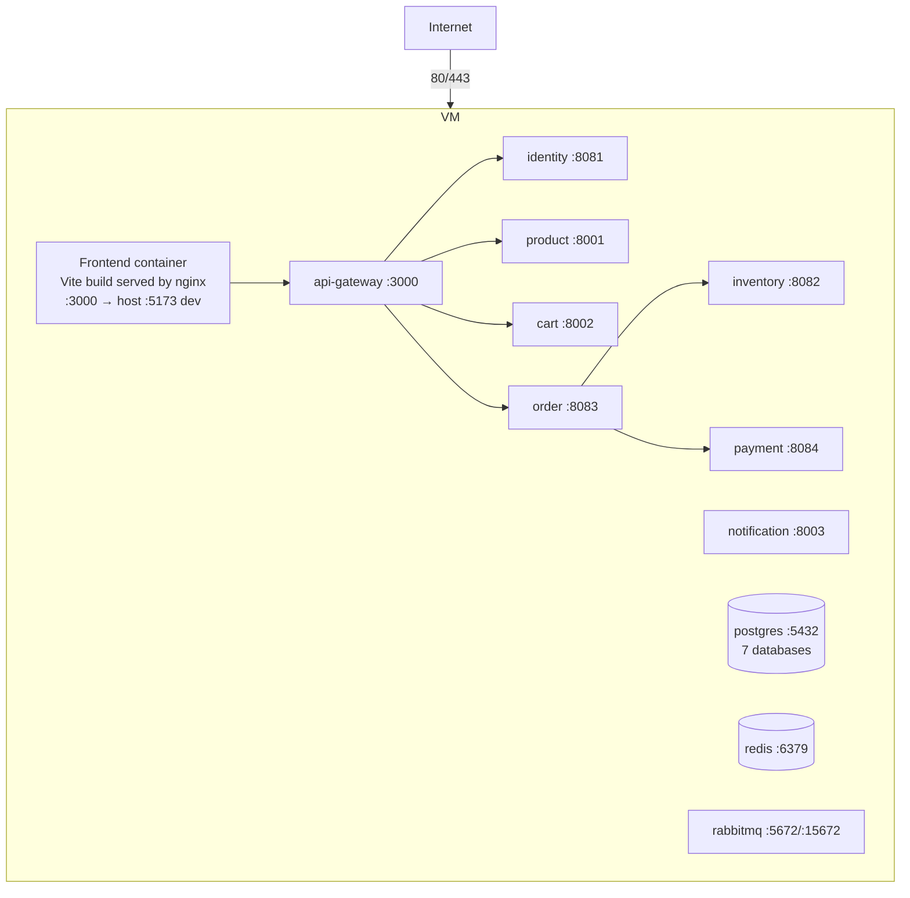

# Deployment Architecture

MVP target: **one free-tier VM** (or local demo) running Docker Compose. No Kubernetes.

Rules: only Frontend and Gateway ports are published to the host in production profile; infra ports (5432/6379/15672) are published only in the dev profile. All services: `restart: unless-stopped`, healthchecks, `depends_on: condition: service_healthy`, named volumes for PostgreSQL/Redis/RabbitMQ, secrets only via `.env` (see `.env.example`). CI (GitHub Actions) builds + tests each service; image publishing to GHCR and VM deploy are Week 7 tasks.
