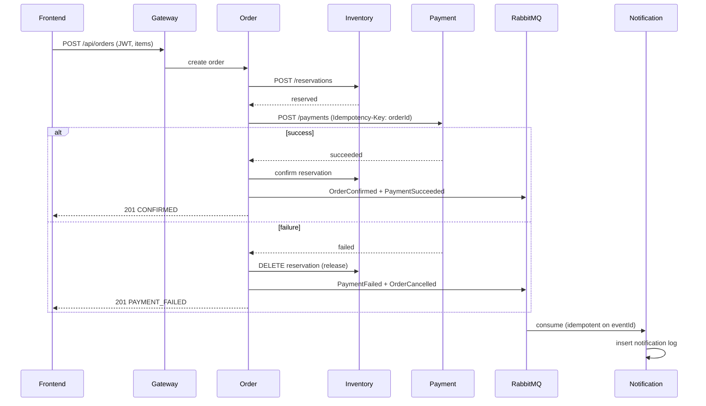

# Service Communication

## Synchronous (REST)

| Caller → Callee | Purpose | Timeout / failure |
|---|---|---|
| Frontend → Gateway | all client traffic | — |
| Gateway → Identity/Product/Cart/Order | proxy + JWT verify | 5 s, 502 on downstream down |
| Order → Inventory | `POST /reservations`, `DELETE /reservations/{id}`, `POST /reservations/{id}/confirm` | 3 s; failure → order not created |
| Order → Payment | `POST /payments` (idempotency key = orderId) | 5 s; failure/timeout → release stock, `PAYMENT_FAILED` |

No other sync service-to-service calls. Product data needed at checkout is fetched Gateway→Product by the **frontend** before checkout, and Order re-validates price via one Product call *only if* we accept that coupling — MVP decision: frontend sends items, Order trusts gateway-validated items but snapshots the prices **as sent**, and Inventory is the only hard dependency. (Trade-off recorded: a tampered price requires a valid JWT + is visible in order audit; server-side price re-validation is a Week 7 hardening task.)

## Asynchronous (RabbitMQ)

Exchange: `nexus.events` (topic). Routing key = eventType. Every envelope:

```json
{ "eventId": "uuid", "eventType": "PaymentSucceeded", "occurredAt": "RFC3339",
  "aggregateId": "order-uuid", "correlationId": "uuid", "eventVersion": 1, "payload": {} }
```

Events: `OrderCreated`, `InventoryReserved`, `InventoryReservationFailed`, `PaymentSucceeded`, `PaymentFailed`, `OrderConfirmed`, `OrderCancelled`, `NotificationRequested`.

**MVP usage:** Notification consumes `Order*`/`Payment*` and writes a log row. All consumers are idempotent on `eventId` (processed-events table / Redis SETNX). Saga choreography (Inventory/Payment reacting to events instead of REST) is deferred — ADR-0004.


