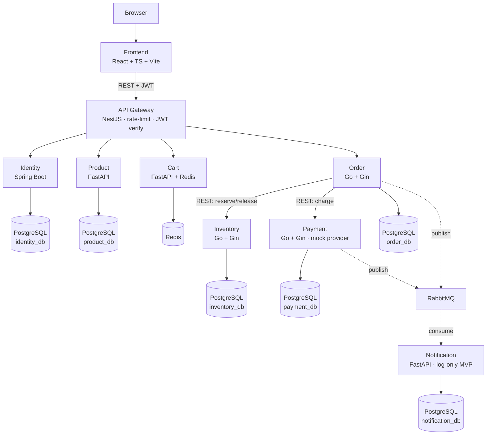
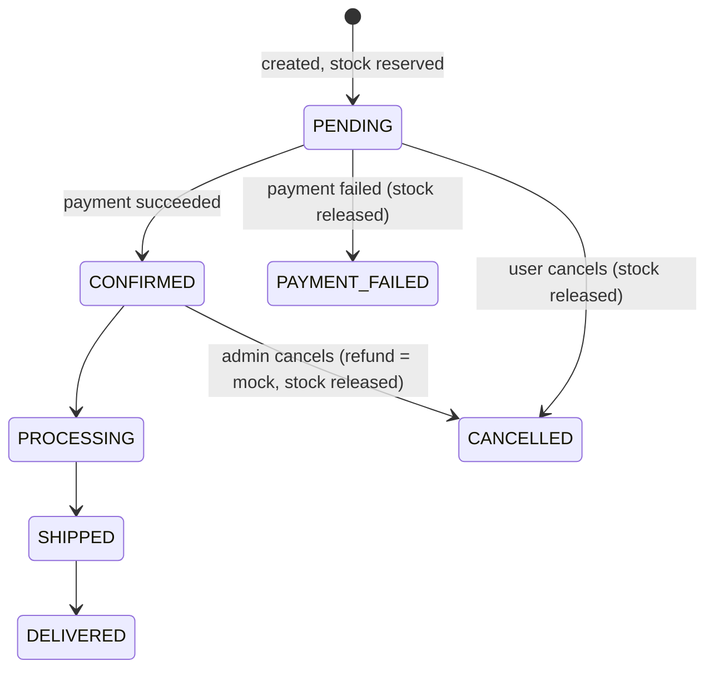

# System Overview — Nexus Commerce

Status: **APPROVED 2026-11-03 · ALL PHASES IMPLEMENTED & VERIFIED 2026-11-03** — all 8 services + frontend run via Docker Compose; full E2E (`tests/e2e.sh`) passes on a fresh `docker compose down -v && up`: register → login → admin stock → cart → checkout success (stock deducted) → payment failure (stock released, `PAYMENT_FAILED`) → RabbitMQ notifications logged → refresh-token rotation (reuse rejected 401) → oversell rejected 409 → cancel CONFIRMED order restocks. Remaining stretch items: choreographed saga (ADR-0004), RS256/JWKS (ADR-0003), Prometheus/Elasticsearch, public cloud deployment.

## 1. Feasibility Verdict

Feasible in 8 weeks at 2–3 h/day (~100–120 h) **only with the cuts in §4**. The original spec describes 8 deployables in 4 languages; without scope control this is a 4–6 month project for one developer.

| Area | Verdict |
|---|---|
| Polyglot services (NestJS/Spring/FastAPI/Go) | Feasible — it's the learning goal. Cost: 4 build/test pipelines |
| Database-per-service | Feasible as separate DBs/schemas on one PostgreSQL instance |
| Event-driven order flow | Feasible if saga is deferred (see ADR-0004) |
| Elasticsearch, Prometheus/Grafana, OpenTelemetry | **Deferred** — optional, post-MVP |
| Real email, real payment | **Out of scope** — log-only notifications, mock payment |

## 2. Final MVP Architecture

One PostgreSQL server, one database + one least-privilege user per service (ADR-0002). No service queries another service's database.

## 3. Corrections to the Original Spec (load-bearing)

1. **Missing stacks:** the stack table assigns no language to Inventory or Cart. Assigned: Inventory = Go+Gin (atomic stock updates, shared patterns with Order/Payment), Cart = Python+FastAPI (Redis, shared patterns with Product). See ADR-0005.
2. **Order lifecycle conflict:** `PENDING → CONFIRMED → PAID` is ambiguous — an unpaid order must not be "confirmed". Corrected lifecycle below; `CONFIRMED` means payment captured.
3. **Sync + async duplication:** spec requires Order→Inventory/Payment synchronously *and* the same flow via events. Doing both causes double-processing. MVP: synchronous reservation + payment (immediate checkout response), events published *after* for notification/audit. Choreographed saga is a Phase 5 stretch goal. See ADR-0004.
4. **Header trust:** gateway-verified identity headers are spoofable by anything inside the network. Every service verifies the JWT signature itself; gateway headers are a cache, not a credential. See ADR-0003.

### Corrected Order Lifecycle

## 4. Scope Cuts to Hit 8 Weeks

| Cut | Replacement |
|---|---|
| Elasticsearch | PostgreSQL `ILIKE` / trigram search |
| Real email (SMTP) | Notification rows + structured log |
| Real payment gateway | Mock provider, deterministic success/failure by test card |
| Prometheus/Grafana/OTel | Structured JSON logs + `/health` endpoints (add in W7 if time) |
| Refresh-token reuse detection | Rotation + revocation list in DB (no family-tree tracking) |
| Kubernetes/service mesh | Docker Compose only (already excluded by spec) |

## 5. Week 1 Tasks (Walking Skeleton)

1. [x] Repo structure, `.gitignore`, `.env.example`, this documentation set
2. [x] `docker-compose.yml`: PostgreSQL, Redis, RabbitMQ with healthchecks + volumes
3. [x] API Gateway (NestJS): `/health`, proxy route `/api/products/**`
4. [x] Product Service (FastAPI): `GET /products`, `GET /products/{id}` (seeded, DB-backed). Alembic migration deferred to Phase 2 when Product gets write endpoints (tables are currently created on startup)
5. [x] Frontend (Vite+React+TS): one page fetching through the gateway
6. [x] GitHub Actions: build + test gateway, product, frontend
7. [x] Verified locally: `docker compose up` → Frontend → Gateway → Product → PostgreSQL returns seeded products (incl. `?q=` search). CI not yet run on GitHub (no remote configured)

**Definition of done, Week 1:** one request traverses Frontend → Gateway → Product → PostgreSQL and back, in Compose, with CI green.
