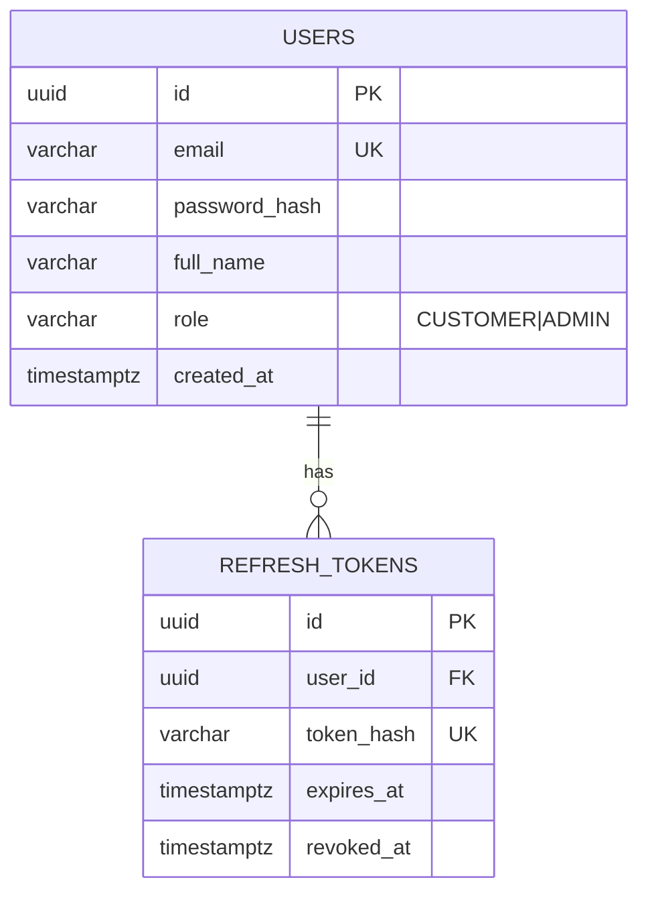
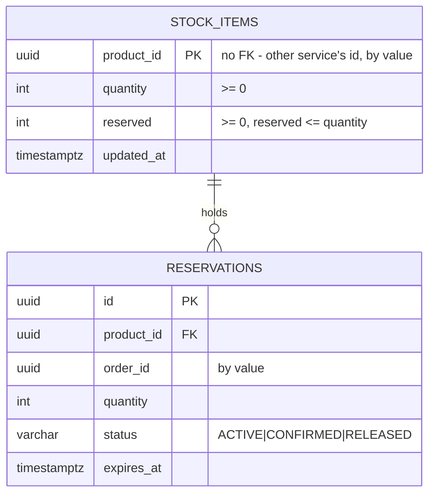
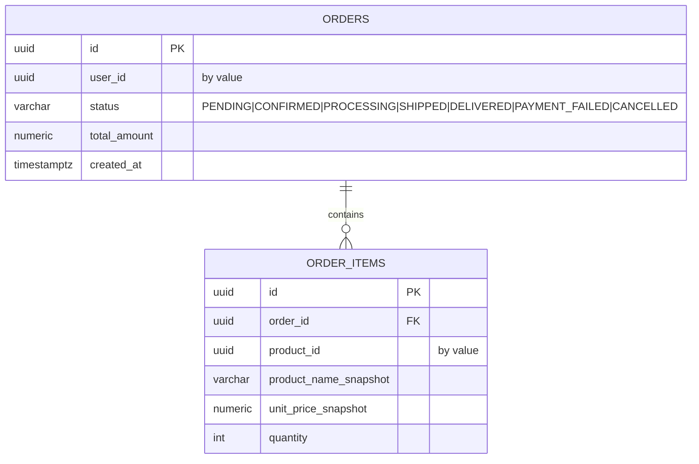
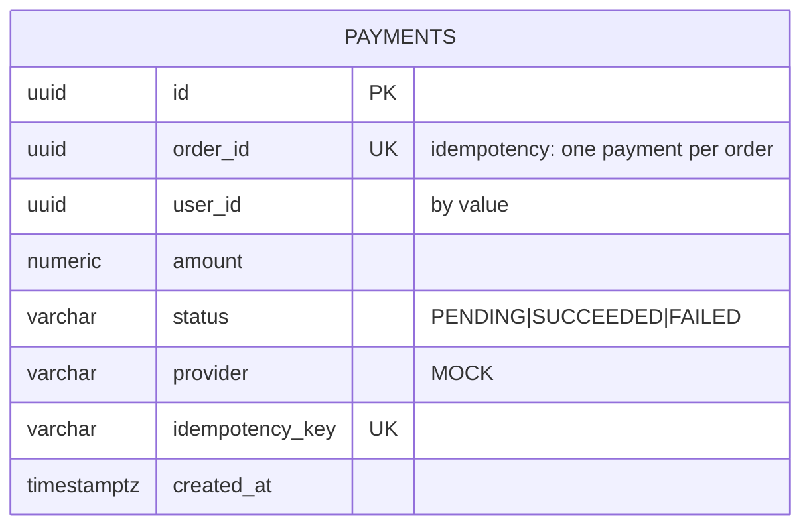

# Entity-Relationship Diagrams (draft — finalized per service in its phase)

## Identity (`identity_db`)



## Product (`product_db`)

```mermaid
erDiagram
    CATEGORIES ||--o{ PRODUCTS : contains
    PRODUCTS ||--o{ PRODUCT_IMAGES : has
    CATEGORIES { uuid id PK, varchar name UK, varchar slug UK }
    PRODUCTS {
        uuid id PK
        uuid category_id FK
        varchar name
        varchar slug UK
        text description
        numeric price ">= 0"
        boolean is_active
        timestamptz created_at
    }
    PRODUCT_IMAGES { uuid id PK, uuid product_id FK, varchar url, int sort_order }
```

Indexes: `products(name)` trigram for search, `products(category_id)`.

## Inventory (`inventory_db`)



Oversell prevention: single atomic `UPDATE ... WHERE quantity - reserved >= $qty`, row count checked.

## Cart (Redis)

Key `cart:{userId}` → hash/JSON `{ items: [{productId, quantity}] }`, TTL 7 days. No relational ERD; prices are **not** stored (resolved at checkout).

## Order (`order_db`)



## Payment (`payment_db`)



## Notification (`notification_db`)

```mermaid
erDiagram
    NOTIFICATIONS {
        uuid id PK
        uuid user_id "by value, nullable"
        varchar event_type
        varchar channel "LOG (MVP)"
        text message
        varchar status "SENT|FAILED"
        timestamptz created_at
    }
    PROCESSED_EVENTS { varchar event_id PK, timestamptz processed_at }
```
